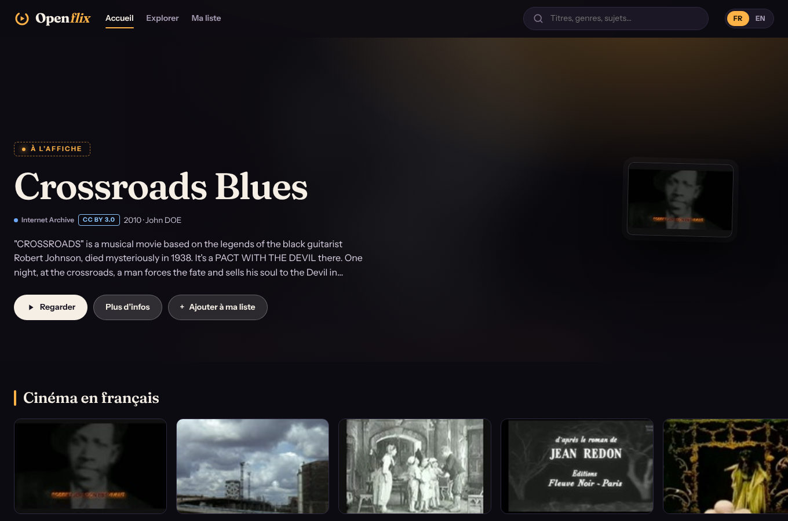

# Openflix

**Une alternative gratuite à Netflix** bâtie sur des sources en ligne libres (Internet Archive, Wikimedia Commons, NASA, PeerTube), en **français et en anglais**, avec un outil de scan qui trouve le **meilleur lien direct** de chaque contenu.

> A free, Netflix-style streaming front-end built on free online sources, in **French and English**, with a scanner that finds the **best direct link** for each title. (English summary at the bottom.)

Aucun fichier n'est copié ni hébergé : l'application trouve les contenus chez leurs sources, choisit le bon fichier, vérifie que le lien répond et affiche la licence.

## Ce que fait l'application

| Écran | Rôle |
|---|---|
| **Accueil** | bannière « À l'affiche », rangées thématiques (cinéma en français ou classiques en anglais, science-fiction, cinéma muet, dessins animés, TV classique, documentaires, NASA, courts métrages libres), « Reprendre la lecture », « Ma liste » |
| **Lecture** | plein écran, choix de la qualité, **reprise automatique**, barre qui s'efface pendant la lecture, raccourcis clavier (**Espace** pause, **←/→** ±10 s, **F** plein écran, **M** muet, **Échap** fermer), repli sur le lecteur de la source |
| **Explorer** | le scanner : recherche multi-sources, filtres (type, **genre, période, langue du contenu, tri**, « licences libres vérifiées », sources), état de chaque source, panneau de liens classés avec « Ouvrir » / « Copier » |
| **Ma liste** | vos titres mis de côté (stockés dans votre navigateur) |

**Langues** : français et anglais, détectées d'après le navigateur, avec un bouton FR / EN. Le catalogue d'accueil s'adapte à la langue.
**Thèmes** : clair et sombre automatiques. **Mobile** : interface adaptée.

## Aperçu

Captures de l'application avec de vraies données (dossier [`docs/captures`](docs/captures)) : accueil sombre et clair, rangées, Explorer et filtres, fiche d'un titre, lecteur, version mobile.



## Mettre en ligne (le plus simple, sans rien installer)

1. Créez un compte sur [render.com](https://render.com) (« Sign in with GitHub »).
2. **New → Blueprint**, choisissez ce dépôt, puis **Apply** : le fichier `render.yaml` fait le reste.
3. Après quelques minutes, Openflix est disponible sur une adresse `https://openflix-….onrender.com`, ouvrable sur ordinateur, téléphone et télévision.

Sur un téléphone ou un ordinateur, le navigateur propose alors « Installer l'application » : c'est la version installable (PWA), sans magasin d'applications. L'offre gratuite de Render met l'application en veille après un moment sans visite (le premier chargement est alors plus long) : voir leur page de tarifs, qui change.

## Direction artistique

Identité « salle de projection » : noir d'encre, lumière ambre de projecteur, titres à empattement, licences en « tampons ». Détails, palette et règles dans [`docs/DESIGN.md`](docs/DESIGN.md). **Le plan pour arriver à une V1 complète est dans [`PLAN-V1.md`](PLAN-V1.md)** ; la vision et les idées dans [`ROADMAP.md`](ROADMAP.md), les idées en attente dans [`BACKLOG.md`](BACKLOG.md).

## Sources

| Source | Contenu | Licence affichée |
|---|---|---|
| **Internet Archive** | vidéos, audio, logiciels/jeux, livres | selon l'item (`licenseurl`) ; sinon « à vérifier » |
| **Wikimedia Commons** | vidéos, audio | licence déclarée par fichier (CC, domaine public…) |
| **NASA Image and Video Library** | vidéos, audio | domaine public (NASA) |
| **PeerTube** (via SepiaSearch) | vidéos | uniquement les vidéos avec une licence CC / CC0 déclarée |

Ajouter une source = un fichier dans `server/src/sources/` qui implémente `search()` et `resolve()` (voir `sources/types.ts`). Les rangées de l'accueil sont dans `server/src/home.ts`.

## Contenu et licences

- **Accueil : licences libres déclarées uniquement.** Internet Archive héberge aussi des œuvres protégées déposées par des internautes (leur licence est « inconnue »). L'accueil ne montre que les titres dont la source déclare une licence libre : domaine public, Creative Commons. Dans **Explorer**, « Licences libres vérifiées » est activé par défaut ; le désactiver ajoute des résultats sans licence déclarée, signalés « Licence à vérifier ».
- **La licence est celle que la personne ayant déposé le fichier a déclarée** : ce n'est pas une garantie juridique. Vérifiez les droits avant toute réutilisation.
- **Filtre « grand public » (activé par défaut).** Internet Archive contient aussi du contenu pour adultes, y compris dans des collections générales comme `feature_films`. Le serveur exclut les collections signalées (`adultvhs`, `no-preview`…) et les titres, descriptions et mots-clés inappropriés (accents ignorés, mots entiers : « Essex » n'est pas bloqué). Il est volontairement strict ; `SAFE_SEARCH=off` le désactive pour un usage personnel.

## Comment le meilleur lien est choisi

1. **Recherche** en parallèle sur les sources. Une source en panne ou lente (15 s max) n'empêche pas les autres de répondre.
2. **Classement des fichiers** d'un item : vidéo MP4/h.264 (lisible partout) > WebM > OGV > MKV… ; meilleure résolution ; versions « 512Kb », fichiers vides, vignettes et métadonnées écartés ; un original de plusieurs Go passe après une version plus légère (Wikimedia propose des WebM transcodés en 240p à 1080p, NASA des déclinaisons large / petite / mobile). Audio : MP3 > M4A/OGG > FLAC > WAV. Logiciels : ZIP. Livres : PDF > EPUB.
3. **Vérification** du lien (requête `HEAD`) : en ligne / hors ligne / non vérifié.
4. **Licence** classée : domaine public, Creative Commons, CC non commercial, droits réservés ou inconnue.

## Démarrage

Prérequis : Node.js 20+.

```bash
npm install
npm run dev          # API sur :8787, interface sur http://localhost:5173
```

Mode « production » (une seule URL) :

```bash
npm run build
npm start            # http://127.0.0.1:8787 sert l'API et l'interface
```

Derrière un proxy d'entreprise, lancez avec `NODE_USE_ENV_PROXY=1` : le proxy résout alors lui-même les noms de domaine, et la vérification DNS locale du serveur (protection contre les adresses privées) est remplacée par la politique de sortie de votre proxy.

### Installer comme une application

L'interface est une **PWA** : depuis Chrome, Edge ou Safari, « Installer l'application » / « Ajouter à l'écran d'accueil » (PC, téléphone, navigateur de TV). Une fois installée, elle s'ouvre en plein écran et **la coquille de l'interface s'ouvre même hors ligne** ; le catalogue et les vidéos, eux, demandent une connexion (le service worker ne met jamais en cache l'API ni les médias).

### Héberger (téléphone, TV, autres appareils)

```bash
docker build -t openflix .
docker run -d -p 8787:8787 --name openflix openflix     # http://localhost:8787
```

| Variable | Défaut | Rôle |
|---|---|---|
| `PORT` | `8787` | port d'écoute |
| `HOST` | `127.0.0.1` (`0.0.0.0` dans l'image Docker) | adresse d'écoute |
| `RATE_LIMIT` | `120` | requêtes `/api` par minute et par IP (`/api/resolve` : 40 ; `0` = illimité) |
| `TRUST_PROXY` | non | `1` derrière un reverse proxy (lit `X-Forwarded-For` pour l'IP réelle) |
| `SAFE_SEARCH` | `on` | filtre « grand public » (voir ci-dessous) ; `off` pour le désactiver |

L'outil n'a **pas d'authentification** : pour l'ouvrir hors de votre réseau, placez-le derrière un reverse proxy HTTPS avec accès restreint (la PWA et le service worker exigent HTTPS, sauf sur `localhost`).

### En ligne de commande

```bash
npm run scan -- "nosferatu" --kind video --resolve
npm run scan -- "apollo 11" --source nasa --free -n 5
```

### Vérifier les sources en réel

Les tests s'appuient sur de **vraies réponses** des quatre API (`server/test/fixtures/`, capturées le 10/11/2026). Pour confirmer que les formats n'ont pas changé, depuis une machine connectée à internet :

```bash
npm run smoke
```

Il interroge chaque source, résout le premier résultat et vérifie son lien. L'accueil réel (`/api/home`) montre aussi vite si une collection Internet Archive a changé de nom : sa rangée reste vide, donc masquée. Wikimedia limite les requêtes par adresse IP : un « 429 » passager est normal, et un lien ainsi limité s'affiche « Non vérifié » (pas « Hors ligne »).

## API

| Route | Rôle |
|---|---|
| `GET /api/home?lang=fr\|en` | rangées de l'accueil (mises en cache 30 min) |
| `GET /api/sources` | liste des sources |
| `GET /api/search?q=&kinds=video,audio&sources=…&freeOnly=1&genre=noir&period=y1950&lang=fr&sort=recent&page=1&limit=24` | scan (résultats entrelacés + état de chaque source) |
| `GET /api/resolve?uid=<source:id>&kind=video[&check=0]` | meilleurs liens d'un item + vérification |

Les erreurs sont renvoyées avec un **code** (`network`, `timeout`, `http`, `blocked`) : l'interface les traduit.

## Structure

```
server/   Fastify + TypeScript : sources, classement des liens, licences, accueil, API, CLI
web/      React + Vite : accueil, lecture, explorer, ma liste, traductions FR/EN
```

```bash
npm test             # 198 tests (serveur + interface), dont des tests sur de vraies réponses d'API
npm run typecheck
```

Ajouter une langue : compléter `web/src/messages.ts` (un test vérifie que chaque langue a exactement les mêmes clés) et `Lang` dans `server/src/types.ts`.

## Sécurité

Les URL de fichiers viennent de tiers (ex. instances PeerTube). Toute requête sortante du serveur passe par `server/src/http.ts` : http(s) uniquement, ports standards, hôtes publics seulement (adresses privées, loopback et link-local refusées, y compris après résolution DNS et à chaque redirection). Le lecteur intégré d'une source est affiché dans un `iframe` sandboxé.

Côté serveur : limitation de débit par IP, **politique de sécurité du contenu (CSP)** stricte (scripts et styles uniquement depuis l'application, images/vidéos/lecteurs en https), `nosniff`, `frame-ancestors 'none'`, cache longue durée uniquement pour les fichiers à empreinte.

Accessibilité : les fenêtres (détail, lecteur) gardent le focus clavier à l'intérieur, le rendent à la carte d'origine en se fermant, et se ferment avec Échap.

## Droits d'auteur

Les contenus appartiennent à leurs auteurs et restent hébergés par leurs sources. Une licence « à vérifier » signifie que la source n'en déclare pas : vérifiez les droits avant de réutiliser un contenu. Les jeux « abandonware » restent protégés par le droit d'auteur : seuls les jeux et logiciels que la source déclare libres sont présentés comme tels.

## Suite prévue

- Navigation à la télécommande (flèches) puis application Android TV : l'interface web installable est la base.
- Sous-titres, profils, synchronisation de « Ma liste » entre appareils.

## English summary

Openflix is a Netflix-style front-end over free online sources (Internet Archive, Wikimedia Commons, NASA, PeerTube). It ships a home page with a hero banner and themed rows (French- or English-language picks depending on your language), a full-screen player with automatic resume, a multi-source "Explore" scanner that ranks files and verifies links, and "My list". The interface is available in French and English (auto-detected, switchable with the FR/EN button). It never hosts files: it only finds them at their sources and shows each title's license.

Quick start: `npm install && npm run dev` (Node.js 20+), then open http://localhost:5173. Run `npm run smoke` from a connected machine to check the live sources.
